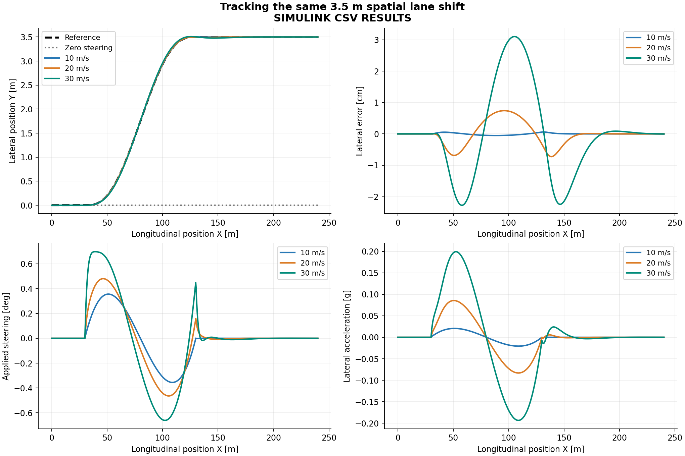
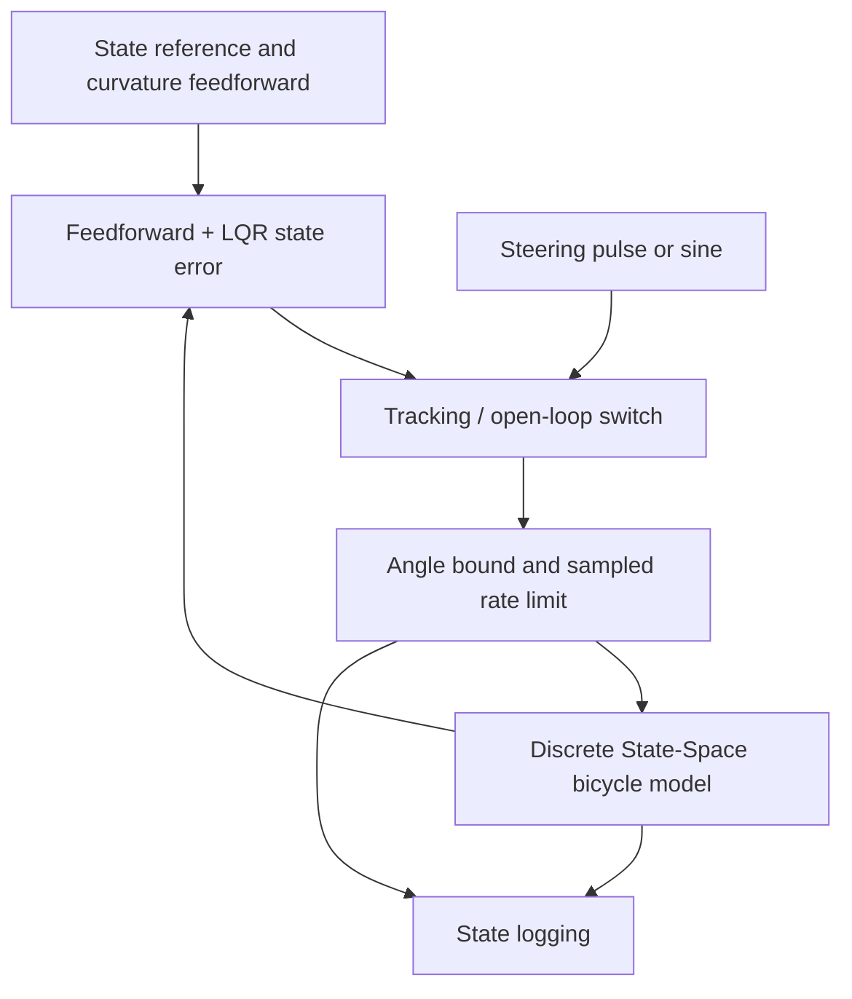
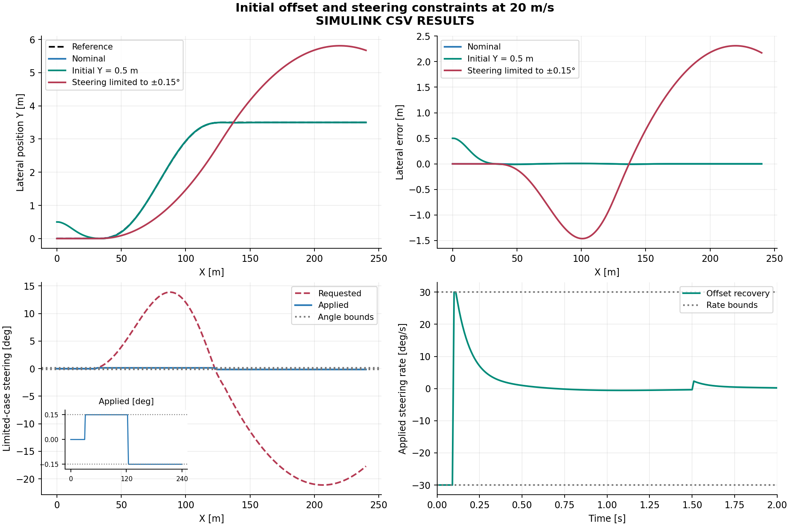

# Vehicle Lateral Dynamics & Path Tracking

**Volkan Akyazici**

**Latest recorded local execution:** MATLAB/Simulink 26.2.0.3386108 (R2026b), 24 October 2026. See [`results/simulink/execution_status.json`](results/simulink/execution_status.json) for the saved PASS report.

A four-stage study of lateral vehicle response and lane-shift tracking using a linear dynamic bicycle model. **Simulink is the primary simulation environment.** MATLAB configures and runs the supplied Simulink model, calculates the controller, and checks the results. Python reads exported CSV files and produces metrics and figures.

The progression is:

1. **Dynamic Bicycle Model:** derive the lateral/yaw dynamics and verify the equations.
2. **Steering Input Response:** investigate a steering pulse and a sinusoidal input.
3. **Speed Comparison:** apply the same steering input at 10, 20, and 30 m/s.
4. **Path Tracking Controller:** use discrete LQR feedback and curvature feedforward, including actuator limits and an initial-offset experiment.

## Main results

I ran the four-stage scenario suite in MATLAB/Simulink R2026b and used Python to analyze the exported Simulink histories.

- **12/12 Simulink cases passed** the recorded implementation checks; **21/21 MATLAB mathematical checks passed**.
- Under nominal LQR lane-shift tracking, path RMSE increased from **0.000258 m** at 10 m/s to **0.013944 m** at 30 m/s.
- At 20 m/s, starting **0.5 m off the reference path** increased full-run RMSE to **0.1043 m**, while the final error approached zero.
- Restricting steering to **±0.15°** and **3°/s** increased 20 m/s path RMSE from **0.0036 m** to **1.330 m**; the angle limit was active for **10.4 s**. Both actuator limits changed in this experiment.
- With zero steering in the same lane-shift scenario, the model retained a final **-3.5 m** lateral path error.



Detailed experiment settings and interpretations are in [My experiments](docs/my_experiments.md). Numeric agreement and validation limits are recorded in [Validation](docs/VALIDATION.md). These are **simulation results**, not predictions validated against a measured vehicle.

## Run the project

**Requirements:** MATLAB with Simulink and Python 3.10+ with `requirements.txt`. The implementation does not require Control System Toolbox, Vehicle Dynamics Blockset, or Automated Driving Toolbox.

From the project root in MATLAB:

```matlab
cd matlab
run_project
```

`run_project` loads the **included** [`lateral_bicycle.slx`](matlab/lateral_bicycle.slx), runs 21 checks and 12 experiments, exports CSV/JSON files to `results/simulink/`, and opens the Simulink model configured for nominal path tracking at 20 m/s. This repository uses the editable `.slx` as the model source; it does not require a separate model-generation script.

To inspect the model or run one experiment, with MATLAB's Current Folder set to `matlab/`:

```matlab
open_system('lateral_bicycle.slx')
test_math
[T, report] = run_case('step',20);
[T, report] = run_case('track',30);
[T, report] = run_case('limited',20);
```

After any changes to `config.json`, `run_project` reconfigures the existing model for the new parameters; it does not rebuild the block layout. If you edit the Simulink blocks, save the `.slx` file before rerunning the experiments. Model-workspace variables are assigned by `configure_model.m` before simulation. If you have an older copy of `lateral_bicycle` open in MATLAB, close it (`bdclose('lateral_bicycle')`) before opening this repository copy.

From a terminal at the **project root**:

```bash
python3 -m pip install -r requirements.txt
python3 python/analyze.py --input results/simulink
```

The script analyzes the actual Simulink CSV outputs and regenerates `results/simulink/metrics.csv` and five charts under `results/simulink/figures/`. It checks the result provenance and requires a successful full-suite report; it does not simulate the vehicle.

The supplied experiment suite and comparison figures use **10, 20 and 30 m/s**. Editing `speeds_mps` alone does not redefine the complete suite: the steering tests in `run_project.m` and the expected cases/plot layout in `python/analyze.py` also need updating. Other parameter edits should be followed by a complete rerun; the current acceptance thresholds may no longer be satisfied.

For an optional independent numerical preflight that runs without MATLAB:

```bash
python3 tests/check_numerics.py
```

This check writes separate Python-only preview files under `results/preview/` (ignored by Git). These preview files are **not** Simulink results.

## Model and coordinates

The vehicle has two dynamic degrees of freedom: lateral translation and yaw. Global heading and lateral position are added as kinematic states:

$$x=[v_y,\ r,\ \psi,\ Y]^T,\qquad u=\delta.$$

Body axes point forward and left. Positive steering, yaw rate, and heading turn left. `delta` is the equivalent **front road-wheel angle**, not the steering-wheel angle. All equations use SI units and radians; plots convert angles to degrees.

The example parameters are `m = 1500 kg`, `Iz = 2500 kg·m²`, front/rear CG distances `a = 1.2 m`, `b = 1.6 m`, and total front/rear **axle** cornering stiffnesses `Cf = Cr = 80000 N/rad`. These are illustrative parameters, not measurements of a particular vehicle. The fixed sample period is `Ts = 0.01 s`.

The linear tire-slip convention is:

$$
\alpha_f=\delta-\frac{v_y+ar}{U},\qquad
\alpha_r=-\frac{v_y-br}{U},
$$

$$F_{yf}=C_f\alpha_f,\qquad F_{yr}=C_r\alpha_r.$$

Newton's laws in the rotating body frame give:

$$
m(\dot v_y+Ur)=F_{yf}+F_{yr},\qquad
I_z\dot r=aF_{yf}-bF_{yr}.
$$

Small-heading global kinematics are:

$$\dot\psi=r,\qquad\dot Y=v_y+U\psi,\qquad X=Ut.$$

Consequently, $\dot x=Ax+B\delta$, with:

$$
A=\begin{bmatrix}
-\frac{C_f+C_r}{mU} & \frac{bC_r-aC_f}{mU}-U & 0 & 0\\
\frac{bC_r-aC_f}{I_zU} & -\frac{a^2C_f+b^2C_r}{I_zU} & 0 & 0\\
0&1&0&0\\
1&0&U&0
\end{bmatrix},\qquad
B=\begin{bmatrix}C_f/m\\aC_f/I_z\\0\\0\end{bmatrix}.
$$

`model_matrices.m` computes exact zero-order-hold discretization using the augmented matrix exponential:

$$
\exp\left(T_s\begin{bmatrix}A&B\\0&0\end{bmatrix}\right)
=\begin{bmatrix}A_d&B_d\\0&1\end{bmatrix},\qquad
x_{k+1}=A_dx_k+B_d\delta_k.
$$

This is exact for the stated linear model with a held input; it does not make the physical vehicle model exact. The full model contains position/heading integrators. Stability checks distinguish its lateral two-state subsystem from the closed-loop four-state system.

## Simulink architecture



The plant is a visible **Discrete State-Space** block with `C = eye(4)` and `D = zeros(4,1)`. The controller uses Sum and matrix Gain blocks. Saturation blocks and a Unit Delay implement steering angle/rate constraints. From Workspace blocks use held samples and explicitly hold the final input value. To Workspace blocks record states, requested steering, and applied steering at every sample.

`reference_loop.m` independently executes the sampled equations in MATLAB for implementation comparison. It is a verification reference; the production experiment CSVs are exported from the Simulink logs.

## Controller and path

The reference is a 3.5 m lane shift starting at `X = 30 m`, extending over 100 m, with a total simulated distance of 240 m. With $q=\operatorname{clip}((X-30)/100,0,1)$:

$$
Y_{ref}=3.5(10q^3-15q^4+6q^5),\qquad
\theta_{road}\approx Y'_{ref}(X),\qquad\kappa\approx Y''_{ref}(X).
$$

The first and second spatial derivatives vanish at both ends of the transition. Curvature uses the small-heading approximation, consistently with the plant kinematics.

Let $L=a+b$ and $K_{us}=\frac{m}{L}(\frac{b}{C_f}-\frac{a}{C_r})$. Quasi-steady references are:

$$
r_{ref}=U\kappa,\quad
\beta_{ref}=\left(b-\frac{maU^2}{LC_r}\right)\kappa,
$$

$$
x_{ref}=\begin{bmatrix}U\beta_{ref}&U\kappa&\theta_{road}-\beta_{ref}&Y_{ref}\end{bmatrix}^T,
\qquad\delta_{ff}=(L+K_{us}U^2)\kappa.
$$

The body-heading reference accounts for sideslip. Aligning the vehicle body with the road tangent is not generally sufficient to follow the path.

The steering request is:

$$\delta_{req,k}=\delta_{ff,k}+K(x_{ref,k}-x_k).$$

`design_controller.m` solves the discrete Riccati equation using base-MATLAB iteration. For nominal error dynamics, it minimizes a quadratic state-error and feedback-input cost with:

$$Q=\operatorname{diag}\left(1/[0.5,\ 0.2,\ 0.05,\ 0.3]^2\right),\qquad R=1/0.05^2.$$

The entries normalize different state units; they are tuning choices, not proven optimal physical limits. A gain is computed separately for each constant-speed experiment. This is not a test of gain scheduling during acceleration.

The actuator first clips the requested angle, then limits its sample-to-sample change:

$$\delta_b=\operatorname{clip}(\delta_{req},-\delta_{max},\delta_{max}),$$

$$\delta_k=\delta_{k-1}+\operatorname{clip}(\delta_b-\delta_{k-1},-\dot\delta_{max}T_s,\dot\delta_{max}T_s).$$

Nominal limits are ±5° and 30°/s, with initial applied steering zero. The Riccati design does not include these constraints; constrained operation is evaluated separately. Quasi-steady references also leave transient reference mismatch, so zero tracking error is not guaranteed.

## Experimental results

All results below are from the **saved local Simulink run**, using the illustrative vehicle parameters. I used `python/analyze.py` to calculate metrics and generate figures from its CSV exports. See [My experiments](docs/my_experiments.md) for test-by-test observations.

| Experiment                         |  Speed |  Path RMSE |
| ---------------------------------- | -----: | ---------: |
| Nominal lane-shift tracking        | 10 m/s | 0.000258 m |
| Nominal lane-shift tracking        | 20 m/s | 0.003579 m |
| Nominal lane-shift tracking        | 30 m/s | 0.013944 m |
| Initial lateral offset (0.5 m)     | 20 m/s | 0.104332 m |
| Restricted steering (±0.15°, 3°/s) | 20 m/s | 1.329678 m |
| Zero steering baseline             | 20 m/s | 2.758471 m |

The four experimental stages were:

1. **Dynamic Bicycle Model:** derive and test the state-space model and its discretization.
2. **Steering Input Response:** apply a 0.3° pulse from 1–5 s and a 0.3°, 0.5 Hz sine input from 1–7 s (separate 10 s experiments).
3. **Speed Comparison:** repeat the steering pulse at 10, 20, and 30 m/s; compare steady yaw-rate gains against $r/\delta=U/(L+K_{us}U^2)$.
4. **Path Tracking:** track a 3.5 m lane shift, test an initial position error, and evaluate severe actuator constraints.

For nominal tracking at 30 m/s, peak axle slip was approximately **1.16°** and peak lateral acceleration was approximately **0.199 g**. The higher-speed cases exhibit greater tracking demand. The limited-actuator experiment demonstrates how saturation can sharply degrade tracking even when the linear tire-state screening criteria are met.

Path RMSE is computed over the entire spatial run, including the straight sections, using sampled left endpoints: $\sqrt{\frac{1}{N-1}\sum_{k=0}^{N-2}(Y_k-Y_{ref,k})^2}$. The plotted lateral error is a global-Y difference, not exact Frenet normal distance.



Additional plots show open-loop steering responses, speed comparisons, and the difference between body heading and sideslip.

## Verification

The MATLAB test suite checks model force balance, analytic steady yaw gain, lateral stability, closed-loop discrete eigenvalues, Riccati convergence, zero-input behavior, input-sign symmetry, and sample-period refinement. The recorded verification details are in [Validation](docs/VALIDATION.md). Each Simulink case also compares logged states and steering signals against `reference_loop.m`, with a state-component tolerance of `1e-8` and a steering tolerance of `1e-9 rad`.

For nominal tracking and offset recovery, the script requires full-run path RMSE below 0.15 m and final absolute path error below 0.02 m. The constrained run is _intentionally_ not held to this tracking-performance limit. Each case separately screens axle-slip angle below 3°, absolute body heading below 10°, and lateral acceleration below 0.3 g. These are project-level screening criteria, not industry validation thresholds.

There is no physical testing, estimator, sensor-noise study, or uncertainty quantification in this version. Matching MATLAB and Simulink does not establish accuracy against a real vehicle.

## Scope and limitations

- Constant forward speed of at least 5 m/s; no longitudinal dynamics or braking.
- Small tire slip and small global heading; the path error is a global-Y difference, not an exact Frenet normal distance.
- Linear axle tire forces; no friction saturation, combined slip, load transfer, roll, suspension dynamics, or tire relaxation.
- Perfect state feedback; no sensor noise, estimator, delay, or parameter mismatch experiments.
- Rate/angle-limited ideal steering; no steering motor or steering-wheel dynamics.
- No integral action, robustness guarantee, or real-vehicle calibration. A persistent disturbance can leave a steady tracking error.

## Repository guide

- `config.json`: shared physical parameters, path settings, and controller tuning.
- `matlab/`: model derivation, controller design, execution, export, and verification.
- `python/analyze.py`: CSV-only metrics and plotting.
- `tests/check_numerics.py`: optional independent Python preflight (creates ignored preview files).
- `matlab/lateral_bicycle.slx`: committed, editable Simulink block model.
- `results/simulink/`: local MATLAB/Simulink CSV exports, verification reports, and Python figures.
- [My experiments](docs/my_experiments.md): configurations, figures, measured outcomes and engineering observations.
- [Validation](docs/VALIDATION.md): execution reports, acceptance criteria and verification limits.

## Technical references

- [MathWorks: Modeling a Vehicle Dynamics System](https://www.mathworks.com/help/ident/ug/modeling-a-vehicle-dynamics-system.html) — force balance and linear lateral tire modeling. Stiffness/sign conventions must be checked before reusing equations.
- [MathWorks: Lateral Driver](https://www.mathworks.com/help/vdynblks/ref/lateraldriver.html) — lateral state-space and small-heading modeling context. This project does not use that block.
- [Discrete State-Space](https://www.mathworks.com/help/simulink/slref/discretestatespace.html), [From Workspace](https://www.mathworks.com/help/simulink/slref/fromworkspace.html), and [To Workspace](https://www.mathworks.com/help/simulink/slref/toworkspace.html) — block interfaces.
- [MathWorks: Discrete LQR](https://www.mathworks.com/help/control/ref/lti.dlqr.html) and [SciPy: solve_discrete_are](https://docs.scipy.org/doc/scipy/reference/generated/scipy.linalg.solve_discrete_are.html) — discrete Riccati formulation and numerical comparison.
