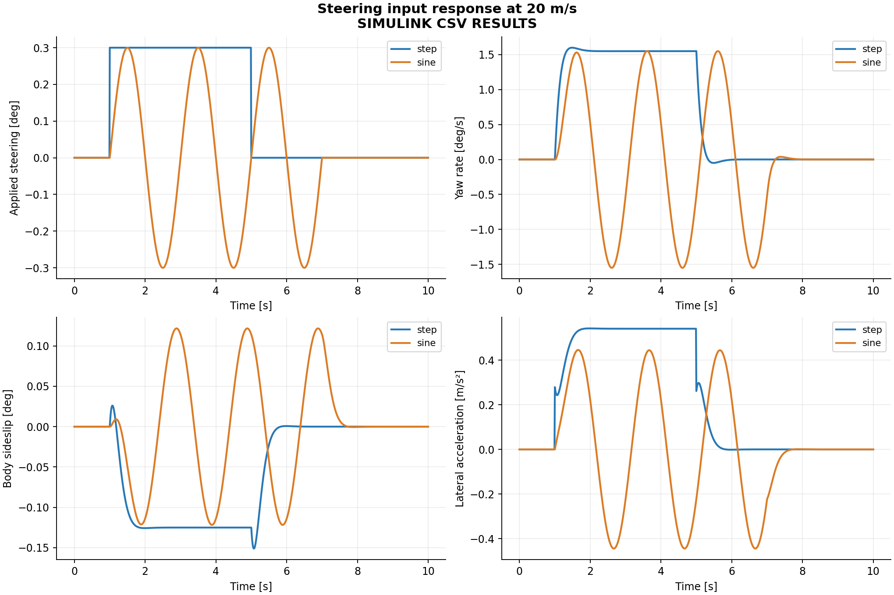
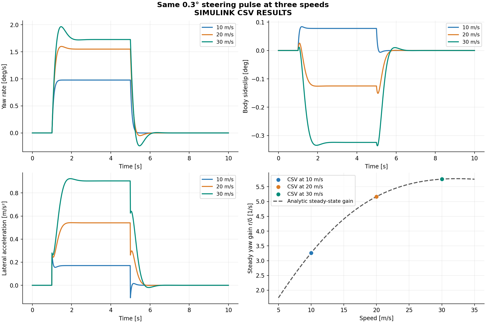

# My Experiments

**Latest recorded run:** 24 October 2026  
**Environment:** MATLAB/Simulink 26.2.0.3386108 (R2026b)  
**Model:** `matlab/lateral_bicycle.slx`  
**Sample time:** 0.01 s

I ran `run_project` in MATLAB on my computer. It completed four stages and generated 12 Simulink case exports. This document records the settings and numerical observations from that run. The individual `.csv` and `.json` files in `results/simulink/` are the underlying evidence; figures were generated afterward using `python/analyze.py`.

The runs use one *illustrative* linear-tire dynamic bicycle model. These are simulation experiments, not tests on a physical vehicle. The predefined cases are generated by `make_case.m`; I did not separately retune the LQR or calibrate parameters against measured data.

## 01 — Model and open-loop steering response

### Setup

The modeled car has a mass of 1500 kg, yaw inertia of 2500 kg·m², front/rear CG distances of 1.2 m and 1.6 m, and axle cornering stiffnesses of 80,000 N/rad each. Forward speed is held constant for each case.

The initial open-loop input was a **+0.3° steering pulse**, active from 1 s up to 5 s. I compared the response at three constant speeds. A separate 20 m/s case used a **0.3°, 0.5 Hz sine** input from 1 s up to 7 s.

| Pulse case | Speed | Yaw rate at 4.99 s | Final heading at 10 s | Peak lateral acceleration |
|---|---:|---:|---:|---:|
| `step_10` | 10 m/s | 0.01707 rad/s | 3.912° | 0.0285 g |
| `step_20` | 20 m/s | 0.02705 rad/s | 6.199° | 0.0553 g |
| `step_30` | 30 m/s | 0.03015 rad/s | 6.909° | 0.0942 g |

These recorded yaw rates match the model's predicted steady yaw gain, evaluated before the pulse ends, within the case tolerance. The larger speed did not simply triple yaw rate: the model's understeer-gradient term also increases with speed.

Final heading is the value at 10 s, not the maximum during the response. At 30 m/s the heading peaks at about 7.011° before settling to about 6.909°.

### My observation

I found the difference between **yaw rate** and **heading** important. Once the steering pulse returns to zero, yaw rate decays, but the accumulated heading angle remains. As a result, the vehicle does not return to its original straight-line trajectory automatically. This helped me distinguish an open-loop steering response from a closed-loop path-tracking task.

The sine case was useful for checking that the model responds in both steering directions, instead of only to a step-like positive command. It is not a frequency-response sweep; only one sine frequency was tested.



## 02 — Speed comparison

### Question

How does the same +0.3° steering pulse affect lateral response at 10, 20 and 30 m/s?

### Result

The pulse duration, steering magnitude and car parameters were fixed; only the forward speed changed. The peak lateral acceleration increased from approximately **0.028 g** at 10 m/s to **0.094 g** at 30 m/s. Peak body heading rose from about **3.91°** to **7.01°**.

### My interpretation

Speed influences the state-space matrix, tire slip angles and the relationship between steering and yaw response. Holding the steering command constant is not the same as holding path curvature constant. I used this open-loop comparison to establish the speed dependence before evaluating the LQR tracking controller.



## 03 — Nominal path tracking with LQR

### Setup

The reference path is a **3.5 m lane shift** between longitudinal positions 30 m and 130 m, using a smooth fifth-order profile. Each run covers 240 m of forward travel. I evaluated the discrete LQR feedback with curvature feedforward at 10, 20 and 30 m/s.

Nominal steering limits were **±5°** with a **30°/s** steering rate limit. LQR gains were recalculated for each constant-speed case.

| Case | Duration | Path RMSE | Peak absolute path error | Peak steering | Peak lateral acceleration |
|---|---:|---:|---:|---:|---:|
| `track_10` | 24 s | 0.000258 m | 0.000633 m | 0.356° | 0.021 g |
| `track_20` | 12 s | 0.003579 m | 0.007405 m | 0.480° | 0.085 g |
| `track_30` | 8 s | 0.013944 m | 0.031014 m | 0.697° | 0.199 g |

RMSE is computed from `Y_m - Y_ref_m` across the sampled spatial run. The runs have different durations because all three cover the same 240 m at different speeds.

### My observation

The nominal controller followed the reference well under these idealized assumptions. The RMSE increased with speed, and peak steering demand rose from about 0.356° at 10 m/s to 0.697° at 30 m/s. This was a useful example of why tracking performance should be evaluated at more than one operating speed.

The tiny tracking errors should **not** be interpreted as millimeter-accuracy prediction for a real car. The simulation assumes exact state feedback, no disturbances, constant forward speed and a simplified linear tire model.


## 04 — My parameter / constraint comparisons

I compared four 20 m/s cases using the same 3.5 m reference path. These cases were part of the recorded `run_project` suite; the run script generated them automatically.

| 20 m/s experiment | Configuration change | Path RMSE | Final path error |
|---|---|---:|---:|
| `track_20` | Nominal controller and limits | 0.003579 m | 0.000000 m |
| `offset_20` | Initial lateral position = +0.5 m | 0.104332 m | 0.000000 m |
| `limited_20` | Steering angle = ±0.15°, steering rate = 3°/s | 1.329678 m | 2.172331 m |
| `uncontrolled_20` | Applied steering = 0 throughout | 2.758471 m | -3.500000 m |

### Initial-offset recovery

At the beginning of `offset_20`, the vehicle starts 0.5 m away from the nominal lateral reference. The controller initially requests a correction and the logged applied steering reaches the **30°/s rate limit** for approximately **0.12 s**. The peak applied steering was **3.00°**.

**My interpretation:** the controller recovered from the tested initial error and finished close to the reference line, but the full-run RMSE was larger because it includes the initial 0.5 m deviation. I should not compare that RMSE to nominal tracking without mentioning the different initial condition.

### Steering actuator limit

In `limited_20`, the steering angle was restricted to ±0.15°, and the rate limit to 3°/s. The angle limit was active for approximately **10.40 s** of the 12 s experiment. The final global-Y error was **2.172 m**.

**My interpretation:** the LQR still computes a requested steering command, but the applied steering cannot follow it. The actuator constraint breaks nominal tracking performance: the RMSE rises from **0.0036 m** to **1.330 m**. Controller tuning alone cannot remove a physical steering limit.

Both the angle limit and the rate limit were reduced, so this comparison measures their combined effect. Separate runs changing one limit at a time would be needed to isolate each contribution.

### Zero-steering baseline

In `uncontrolled_20`, the car continues straight with zero steering while the reference shifts 3.5 m sideways. Its final error is **-3.5 m**, which helps show what the closed-loop controller actually contributes.


## 05 — MATLAB/Simulink implementation validation

Command used on the recorded run:

```matlab
run_project
```

The mathematical preflight completed **21/21** checks, and all **12/12** saved Simulink cases have `PASS` status. Each Simulink state history and steering command was compared with `reference_loop.m`. Across the recorded case reports, the largest absolute difference in any state component was approximately **4.44e-16** in that component's SI unit; the maximum steering difference was **7.01e-17 rad**.

I treat this as implementation verification, not physical validation: the reference loop and Simulink share the same modeling equations, so agreement cannot prove the linear-tire assumptions are accurate for a real vehicle.

Detailed checks, individual case records and limits are documented in [Validation](VALIDATION.md).

## 06 — What I would test next

These are **future tests, not recorded results**:

- Vary front and rear cornering stiffness independently and compare understeer behavior.
- Add initial heading error, parameter mismatch or sensor noise.
- Compare LQR weighting choices using tracking RMSE and steering activity.
- Test larger curvature demands and document when the small-angle model becomes invalid.

The existing log establishes a reproducible baseline for those additional experiments.
